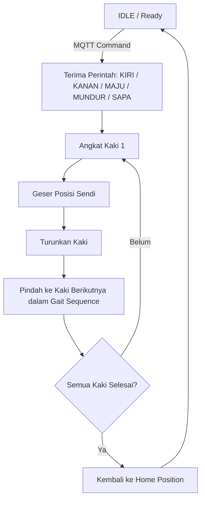

# 🕷️ Quadruped Spider Robot (2-DOF FSM Gait Control)

Robot laba-laba berkaki empat (*4-legged quadruped robot*) berbasis mikrokontroler **ESP32** dengan konfigurasi **2 Degrees of Freedom (DOF)** per kaki. Proyek ini mengimplementasikan arsitektur **Finite State Machine (FSM)** untuk navigasi gerak (maju, mundur, belok kiri, belok kanan, dan mode menyapa) serta kendali nirkabel jarak jauh menggunakan protokol **MQTT**.

## 🧠 System Architecture & Features

Sistem dirancang secara modular menggunakan *non-blocking execution* agar pergerakan 8 motor servo berjalan mulus tanpa jeda (`delay`).

- **2-DOF per Leg**: Setiap kaki digerakkan oleh dua motor servo (servo angkat/*knee* dan servo geser/*hip*).
- **Non-Blocking Smooth Interpolation**: Menggunakan fungsi cosinus `(1 - cos(progress * PI)) / 2.0` untuk menghasilkan akselerasi dan deselerasi servo yang halus.
- **Finite State Machine (FSM)**: Mengatur siklus langkah (*gait cycle*) kaki secara terstruktur untuk setiap arah pergerakan.
- **MQTT Telemetry & Control**: Menerima perintah jarak jauh dan mengirimkan status robot secara *real-time* melalui broker MQTT (`broker.emqx.io`).
- **OLED Display UI**: Layar SSD1306 (128x64) menampilkan ekspresi wajah/status robot (senyum, tidur, excited) berdasarkan kondisi koneksi dan aktivitas.

## 📌 Pin Mapping & Hardware Configuration

| Komponen | Pin ESP32 / Keterangan |
|---|---|
| SDA / SCL (OLED) | GPIO 21 (SDA), GPIO 22 (SCL) |
| Left Front (LF) | Pin 13 (Hip: 105°) |
| Right Front (RF) | Pin 12 (Hip: 115°) |
| Left Back (LB) | Pin 15 (Hip: 95°) |
| Right Back (RB) | Pin 25 (Hip: 65°) |
| Left Front Knee (LFK) | Pin 17 (Knee: 160°) |
| Right Front Knee (RFK) | Pin 16 (Knee: 50°) |
| Left Back Knee (LBK) | Pin 19 (Knee: 155°) |
| Right Back Knee (RBK) | Pin 18 (Knee: 20°) |

## ⚙️ Finite State Machine (FSM) Flow

Pergerakan navigasi (maju, belok, dan sapa) diatur menggunakan multi-state terpisah agar setiap kaki dapat diinisiasi secara bergantian tanpa saling bertabrakan:



## 📡 MQTT Topics & Commands

**Broker:** `broker.emqx.io` : `1883`

| Topik (Command) | Payload | Fungsi | Topik (Status) |
|---|---|---|---|
| `simulation/kiri/cmd` | `KIRI` | Menggerakkan robot berbelok ke kiri | `simulation/kiri/status` |
| `simulation/kanan/cmd` | `KANAN` | Menggerakkan robot berbelok ke kanan | `simulation/kanan/status` |
| `simulation/maju/cmd` | `MAJU` | Menggerakkan robot berjalan maju | `simulation/maju/status` |
| `simulation/mundur/cmd` | `MUNDUR` | Menggerakkan robot berjalan mundur | `simulation/mundur/status` |
| `simulation/hallo/cmd` | `SAPA` | Menjalankan mode gestur menyapa | `simulation/hallo/status` |

## 💻 Software Stack

- **IDE:** Visual Studio Code
- **Framework:** Arduino / ESP32 Core
- **Libraries:**
  - `PubSubClient` (MQTT Client)
  - `ESP32Servo` (PWM Servo Control)
  - `Adafruit_SSD1306` & `Wire` (OLED Display)

## 🚀 Getting Started

1. Klon repository ini:

   ```bash
   git clone https://github.com/THEALITZ08/Quadraped-2-dof.git
   ```

2. Buka folder proyek menggunakan VS Code dengan ekstensi PlatformIO, atau gunakan Arduino IDE.
3. Sesuaikan kredensial WiFi pada kode:

   ```cpp
   const char* ssid = "NAMA_WIFI";
   const char* password = "PASSWORD_WIFI";
   ```

4. Hubungkan ESP32 ke komputer, kompilasi (*compile*), dan unggah (*upload*) program ke mikrokontroler.